# Technical Design Document — INTRVL Time Tracking & Resource Management Platform

**Document type:** TDD (Technical Design) — **Architecture Synthesis (final)**
**Product (working name):** INTRVL ("betterharvest")
**Status:** **Final — Architect sign-off ready**
**Author:** Architecture Lead (Forge `arch_synthesis` phase)
**Date:** 2026-06-19
**Version:** 2.0 (supersedes TDD v1.0 draft)
**Sources of record:** `docs/PRD.md` v1.0, `docs/TDD.md` v1.0 (tech design draft), `docs/DESIGN_SYSTEM.md` v1.0 (UX). FR/NFR/AC/State-machine IDs referenced throughout.

> **What this synthesis did.** v1.0 of the TDD left every diagram marked `PLACEHOLDER` and deferred the UI-layer technology to the UX phase. The UX phase (`docs/DESIGN_SYSTEM.md`) resolved those UI decisions and introduced front-end interaction contracts. This v2.0 **(a)** finalises all Mermaid diagrams (context, container, component, **class**, ERD, runtime flows, state machines); **(b)** folds the resolved UI stack back into the technology section; **(c)** confirms every v1.0 `ASSUMPTION` as a locked decision; **(d)** adds a **Front-End Architecture** section (§7) synthesising the design system into technical terms; and **(e)** records a **Conflict-Resolution Log** (§20) reconciling technical and UX design. It does **not** implement code; diagrams are design artefacts. The former §19 "Open Items for Synthesis" is now **§24 — Closed Synthesis Items**.

---

## 0. Document Map

| § | Section | Synthesis status |
|---|---|---|
| 1 | Architectural goals & driving forces | Carried forward |
| 2 | Key decisions & ADR log (assumptions → locked) | **Finalised** |
| 3 | Technology stack (UI folded in) | **Finalised** |
| 4 | System context (C4 L1) | **Diagram finalised** |
| 5 | Container / deployment view (C4 L2) | **Diagram finalised** |
| 6 | Module decomposition + component (C4 L3) + **class** diagrams | **Finalised** |
| 7 | Front-end architecture (from Design System) | **New** |
| 8 | Cross-cutting concerns | Expanded |
| 9 | Data model + ERD | **Diagram finalised** |
| 10 | Key runtime flows (7 sequences) | **Finalised** |
| 11 | State machines (14, centrally enforced) | **Finalised** |
| 12 | Integration points & contracts | Carried forward |
| 13 | API surface & conventions | **New** |
| 14 | Security design | Carried forward |
| 15 | Non-functional mapping | Carried forward |
| 16 | Deployment assumptions | Carried forward |
| 17 | Local run strategy | Carried forward |
| 18 | UAT seed strategy | Carried forward |
| 19 | Observability & operations | Carried forward |
| 20 | **Conflict-resolution log (TDD ↔ UX)** | **New** |
| 21 | Architectural risks & mitigations | Carried forward |
| 22 | Traceability (engine → context → aggregate) | Carried forward |
| 23 | ADR index & sign-off checklist | **New** |
| 24 | Closed synthesis items (was §19 draft) | **Resolved** |

---

## 1. Architectural Goals & Driving Forces

The architecture is shaped by five non-negotiable forces drawn directly from the PRD's cross-cutting governance rules (FR-GOV-1..5) and NFRs:

| # | Driving force | Architectural consequence |
|---|---|---|
| D1 | **Timesheet is the single source of truth** (FR-GOV-1, NFR-3, AC-SYS-1) | One write-authoritative Timesheet aggregate; every other module reads projections derived from approved data. No competing masters. |
| D2 | **Project configuration governs all commercial behaviour** (FR-GOV-2, FR-RATE-3) | Commercial decisions (rate, billable, overtime) are resolved server-side from `ProjectConfiguration`; never accepted from client/user input. |
| D3 | **No state transition without validation + permission + audit + prior-state + history** (FR-GOV-3) | A central **Governance Kernel** mediates *every* state transition. State machines are first-class, centrally enforced (NFR-14). |
| D4 | **100% immutable auditability** (FR-GOV-3, NFR-2, FR-AUD-1) | Append-only, hash-chained **Audit Ledger**; no destructive updates to locked/approved/paid records. |
| D5 | **Reporting/gamification consider only approved data** (FR-GOV-5, FR-REP-6) | Read models / projections built only from `Approved`/`Auto-Approved` states via domain events; drafts excluded by construction. |

Secondary forces: enterprise security & privacy (NFR-1, NFR-13), integration reliability (NFR-10), AI safety (NFR-11), responsive performance (NFR-4), accessibility (NFR-7, WCAG 2.1 AA), and demonstrability via a pre-seeded UAT environment (FR-SEED-1..9).

These five forces are also the UX north stars P1–P8 in the Design System — the front-end (§7) is the same governance model rendered for humans, not a second source of rules.

---

## 2. Key Architectural Decisions & ADR Log

The PRD deferred several decisions (PRD §11); the v1.0 TDD recorded working assumptions. **Synthesis locks them as decisions.** Every row below is a decision of record for Epics & Stories; the "Confirm at sign-off" column flags the few that still want an explicit business nod but have a safe, reversible default.

| ADR | Topic (PRD OQ) | **Locked decision** | Rationale | Sign-off nod? |
|---|---|---|---|---|
| ADR-001 | Architecture style | **Modular monolith**: one ASP.NET Core deployable partitioned into bounded-context modules with enforced boundaries, plus a **separate worker process** for background jobs. Extraction seams kept for AI/DevOps/Reporting (§6.5). | Strong transactional consistency for D1/D4 (timesheet ↔ audit ↔ billing) is far simpler and safer in-process; trivial local run; 27 engines still cleanly bounded. | — |
| ADR-002 | Stack (OQ1) | **.NET 8 (ASP.NET Core) + EF Core 8 + PostgreSQL 16** backend; **React 18 + TypeScript + Vite** frontend. | First-class Microsoft.Identity.Web & Azure DevOps client libraries; `decimal` financial precision; mature state-machine (Stateless) and background-job (Hangfire) ecosystems. Node/NestJS recorded as documented alternative. | — |
| ADR-003 | Harvest role (OQ2) | **Outbound sync target.** INTRVL is master/SoT; approved timesheets push to Harvest. Inbound import = future. | Preserves D1. FR-INT-3 describes submission + reconciliation (outbound). | — |
| ADR-004 | Expense tracking (OQ3) | **Out of scope v1** (confirms NG7). Extension seam only. | Keeps v1 bounded. | Confirm |
| ADR-005 | AI provider (OQ4) | **Pluggable `IAiProvider`; default Anthropic Claude (latest model id resolved at build, see note); Azure OpenAI alternate.** Per-org cost ceiling + minimal-context/PII-minimisation policy. | Avoids lock-in (NFR-11); supports data residency. | Confirm budget |
| ADR-006 | SLAs (OQ6) | **Adopt NFR-4 figures as binding SLAs:** grid load ≤ 2s (P95), validation feedback ≤ 300ms perceived (P95), reports reflect latest approved data with no stale cache. | Concrete, testable targets for Epics. | Confirm |
| ADR-007 | Strict allocation (OQ7) | **Default = warn (non-strict).** Per-project `strictAllocation` flag flips Appendix-A rule #9 to BLOCK. UAT seed = warn. | Conservative auto-approval (R5); configurable (NFR-9). | — |
| ADR-008 | Multi-tenancy (OQ8) | **Single organisation per deployment in v1; every aggregate carries `OrganisationId`** + an EF global query filter wired but defaulted to the single org. SaaS multi-tenant becomes a config switch later — no migration. | Future-proof without v1 complexity. | — |
| ADR-009 | Federation (OQ9) | **Local email/password auth = v1 MUST; Keycloak/Azure AD OIDC behind `IAuthProvider` (SHOULD).** UAT uses local auth. | FR-IAM-1 (MUST) vs FR-IAM-9 (SHOULD). | — |
| ADR-010 | Harvest migration (OQ10) | **Not required v1.** | Aligns ADR-003. | — |
| ADR-011 | Currency / tax (OQ11) | **ZAR + 15% VAT default; multi-currency in data model; single invoicing currency per client in v1.** | UAT is ZAR (FR-SEED-3). | Confirm VAT |
| ADR-012 | Notification channels (OQ12) | **In-app + email = v1 MUST; Microsoft Teams = SHOULD; SMS out.** Channel abstraction. | FR-NOT-1. | — |
| ADR-013 | Product name (OQ13) | **INTRVL** product, **betterharvest** repository. | PRD §1. | Confirm |
| **ADR-014** | **UI component foundation** (was TDD §3 deferral / DESIGN_SYSTEM §9) | **Radix UI primitives + Tailwind CSS in the shadcn/ui pattern (owned, in-repo components).** Mantine/MUI documented alternatives. | Accessible-by-default primitives (WCAG 2.1 AA, NFR-7); custom product visual language; no vendor lock-in for a long-lived 27-engine platform; tokens map cleanly to Tailwind. | — |
| **ADR-015** | **Data grid / charts / forms / tokens** (DESIGN_SYSTEM §9) | **TanStack Table v8 + TanStack Virtual** (TimesheetGrid, AllocationBoard, DrillDownTable); **Recharts** primary + **visx** bespoke; **React Hook Form + Zod** (client-side mirror of server rules); **Style Dictionary → CSS custom properties → Tailwind** token pipeline; **Lucide** icons; **react-i18next + Intl**. | Headless grid for the dense, editable, keyboard-navigable matrix; single token source for light/dark + density; client validation mirrors server FluentValidation for instant feedback (server stays authoritative — see ADR-016). | — |
| **ADR-016** | **Authoritative validation boundary** (conflict resolution) | **Server FluentValidation + Governance Kernel are authoritative; client Zod is UX-only and never trusted for commercial fields.** | D2/FR-GOV-4: rate/billable/overtime are resolved server-side; client schemas accelerate feedback only. | — |
| **ADR-017** | **Hours representation** (DESIGN_SYSTEM §11/§13) | **Decimal hours end-to-end** (`numeric(5,2)`, e.g. `7.50`); UI displays decimal (`7.5h`). hh:mm is a display-only formatting option, never the storage form. | Matches Appendix-B allocation maths; avoids rounding ambiguity in billing. | — |
| **ADR-018** | **Persisted state vs UI display status** (conflict resolution) | **The aggregate state machine (§11) is canonical and persisted; FR-TS-9 surfaces ("In Progress / Validation Warning / Compliant / Ready for Submission") are derived display statuses computed from `Draft` + live validation, not stored states.** | Reconciles PRD §9 state list with FR-TS-9 UI surface; keeps the state machine minimal and auditable. | — |
| **ADR-019** | **Dark mode** (DESIGN_SYSTEM §8.1) | **Ship light-first; dark theme is a token remap (SHOULD), tokens authored now so it is "free" later.** | Token pipeline (ADR-015) makes it a non-migration. | — |

> **AI model-id note (ADR-005).** The default provider is Anthropic Claude; the concrete model id is a configuration value resolved at build/deploy time against the latest available Claude model, not hard-coded in the domain. The `IAiProvider` abstraction means a model/provider change is a config change, not a code change.

---

## 3. Technology Stack & Versions (finalised)

UI rows previously marked "set in UX phase" are now locked per ADR-014/015.

| Layer | Technology | Version (pinned baseline) | Notes |
|---|---|---|---|
| Backend runtime | .NET / ASP.NET Core | **.NET 8 LTS** | Minimal APIs + controllers; LTS. |
| Language (backend) | C# | 12 | Nullable reference types on. |
| ORM / data access | Entity Framework Core | 8.x | Code-first migrations; `decimal/numeric` for money & hours (ADR-017). |
| Database | PostgreSQL | **16** | JSONB for config/snapshots; row-level filter ready for multi-tenancy (ADR-008). |
| Cache / queues | Redis | 7.x | Distributed cache, rate-limit counters, SignalR backplane, Hangfire backing. |
| Background jobs | Hangfire | 1.8.x | Scheduler, auto-submission, DevOps refresh, notification dispatch, projection rebuild. |
| State machines | Stateless | 5.x | One machine per aggregate, registered in the Governance Kernel (§11). |
| Auth (local) | ASP.NET Core Identity + JWT | 8.x | Access/refresh tokens (FR-IAM-2); password policy (FR-IAM-5). |
| Auth (federation) | Microsoft.Identity.Web / OpenIddict | 8.x / 5.x | Azure AD + Keycloak OIDC (FR-IAM-9, SHOULD) behind `IAuthProvider`. |
| Secret protection | ASP.NET Data Protection + envelope encryption | — | PAT/credential encryption at rest (NFR-1, R3); Key Vault in cloud, env key locally. |
| Validation (server, authoritative) | FluentValidation | 11.x | Backs the 35-rule matrix (Appendix A). **Authoritative (ADR-016).** |
| Mapping | Mapster / AutoMapper | — | DTO ↔ domain. |
| AI SDK | Anthropic .NET SDK (+ Azure OpenAI SDK) | latest | Behind `IAiProvider` (ADR-005). |
| Azure DevOps | `Microsoft.TeamFoundationServer.Client` / REST | latest | Work-item query, status, estimates (FR-ADO-*). |
| PDF / export | QuestPDF (PDF), ClosedXML (Excel), CsvHelper (CSV) | latest | Invoices/annexures (FR-INV-10), exports (FR-EXP-1). |
| Realtime | SignalR | 8.x | Validation push, gamification popups, report refresh (FR-REP-6, FR-GAM-5). Redis backplane. |
| Frontend framework | React | **18** | SPA, responsive (NFR-7). |
| Frontend language | TypeScript | 5.x | Strict mode. |
| Frontend build | Vite | 5.x | Fast dev/HMR. |
| Frontend server-state | TanStack Query + Axios | latest | Server state; optimistic grid updates. |
| **UI foundation** | **Radix UI + Tailwind CSS (shadcn/ui pattern)** | latest | **ADR-014.** Owned in-repo components; accessible primitives. |
| **Data grid** | **TanStack Table v8 + TanStack Virtual** | latest | **ADR-015.** Headless, virtualised dense grid. |
| **Charts** | **Recharts (primary) + visx (bespoke)** | latest | **ADR-015.** Dashboards (FR-VIZ-*). |
| **Forms (client)** | **React Hook Form + Zod** | latest | **ADR-015/016.** Client mirror; server authoritative. |
| **Design tokens** | **Style Dictionary → CSS vars → Tailwind** | latest | **ADR-015/019.** One source for light/dark + density. |
| **Icons** | **Lucide** | latest | **ADR-015.** |
| **i18n / formatting** | **react-i18next + Intl** | latest | NFR-8; ZAR default; tabular figures for numerics. |
| Testing (backend) | xUnit + FluentAssertions + Testcontainers | latest | Integration tests against real Postgres. |
| Testing (frontend) | Vitest + React Testing Library + Playwright | latest | E2E for AC scenarios (PRD §7); axe a11y in CI (NFR-7). |
| Arch tests | NetArchTest | latest | Enforce bounded-context boundaries (NFR-14). |
| Containerisation | Docker + Docker Compose | latest | Local + deploy parity (§16–17). |
| Observability | OpenTelemetry + Serilog (structured) | latest | Traces/metrics/logs (NFR-12). |

All versions are pinned baselines; the scaffolding story pins exact patch versions and commits a lockfile.

---

## 4. System Context (C4 Level 1) — finalised

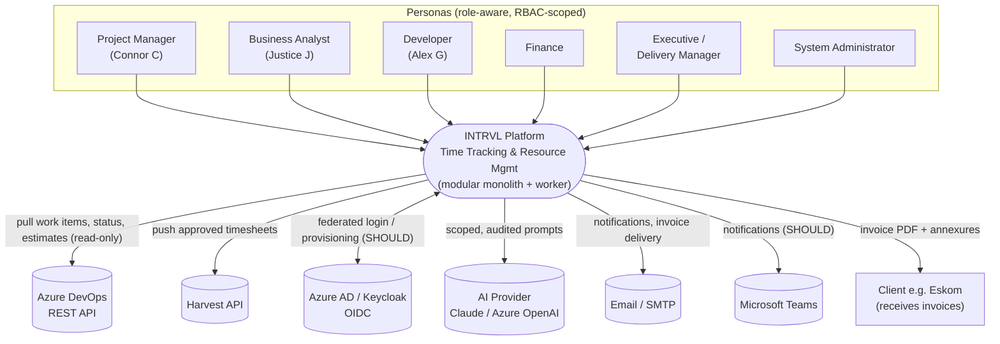

**External dependencies & direction of authority**

| External system | Direction | Authority | Reqs |
|---|---|---|---|
| Azure DevOps | Inbound (pull) | INTRVL never writes work items; reads only | FR-ADO-1..10 |
| Harvest | Outbound (push) | INTRVL is master; Harvest receives approved data | FR-INT-3, ADR-003 |
| Azure AD / Keycloak | Bidirectional (OIDC + provisioning) | IdP authoritative for identity when federated | FR-IAM-9, ADR-009 |
| AI provider | Outbound (request/response) | INTRVL governs scope, permission, audit | FR-AI-*, NFR-11 |
| Email / Teams | Outbound | INTRVL | FR-NOT-1 |

---

## 5. Container / Deployment View (C4 Level 2) — finalised

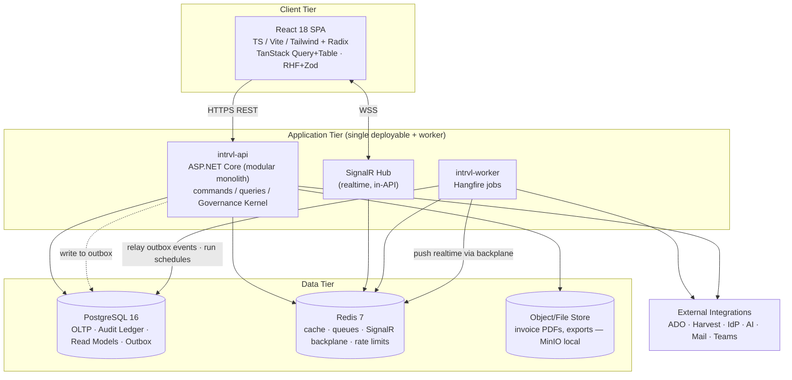

**Process boundaries**
- **API process** — synchronous request handling, real-time validation (NFR-4), command/query handling, governance-mediated state transitions, **writes domain events to a transactional outbox** (never calls integrations inline).
- **Worker process** — Hangfire recurring + queued jobs: auto-submission (FR-AUTO-1, Fri 16:00), DevOps scheduled refresh (FR-ADO-8), notification dispatch + retries (FR-NOT-6), Harvest sync (FR-INT-3), **outbox relay → projections/read models**, audit-pack generation. Decoupling satisfies NFR-6 (jobs never block interactive use).
- **SignalR hub** — pushes validation results, gamification celebrations (FR-GAM-5), live report refresh (FR-REP-6); Redis backplane for scale-out; the worker pushes via the same backplane.
- **Datastores** — PostgreSQL holds OLTP, the append-only hash-chained audit ledger, the outbox, and materialised read models; Redis for cache/queue/backplane/rate-limit; object store for generated PDFs/exports.

**Deployable images:** `intrvl-api`, `intrvl-worker`, `intrvl-web` (static SPA via nginx or API host), plus `postgres`, `redis`, object store (S3-compatible / Azure Blob; local MinIO). See §16.

---

## 6. Module Decomposition & Responsibilities

### 6.1 Layering (every module)

```
API (endpoints, DTOs, authZ filters)
  → Application (commands/queries, validators, state-transition orchestration, AI tool handlers)
    → Domain (aggregates, entities, value objects, state machines, domain events, invariants)
      → Infrastructure (EF Core repositories, integration clients, projections, schedulers)
```

All commercial/governance logic lives in **Domain + Application**, never in API or client. Each module exposes a thin public contract (commands, queries, published events) and keeps internals private — enforced by project references and **NetArchTest** architecture tests (NFR-14).

### 6.2 Bounded contexts (the 27 PRD engines → 9 contexts + Governance Kernel)

| Bounded context | Engines folded in (PRD §5) | Primary aggregates | Key responsibilities | FR refs |
|---|---|---|---|---|
| **Identity & Org** | IAM (5.1), Global Config (5.2), Workforce (5.3) | User, Role, Permission, Department, Team, WorkRule, PublicHoliday | Auth, RBAC + scopes, provisioning (+AI agent), org structure, calendars, capacity | FR-IAM/CFG/WF-* |
| **Clients & Commercials** | Client (5.4), Rate (5.17) | Client, Contract, BillingProfile, RateCard | Client master, contracts, rate cards with effective dating & history | FR-CLI/RATE-* |
| **Projects & Allocation** | Project Portfolio (5.5), Resource Allocation (5.6) | Project, ProjectConfiguration, Task, SubTask, ProjectAssignment, AllocationSnapshot | Project lifecycle, commercial config (governs D2), tasks, allocation %, target hours, ≤100% validation | FR-PRJ/ALLOC-* |
| **Time & Compliance** | Timesheet (5.8), Timer (5.9), Validation (5.10), Approval (5.11), Auto-Submit (5.15), Leave (5.7) | **Timesheet (SoT)**, TimesheetEntry, TimerSession, LeaveRequest, TimeEntryRevision | Capture, timer+rounding, real-time validation (Appendix A), approval-by-exception, auto-submit, leave impact | FR-TS/TIMER/VAL/APR/AUTO/LEAVE-* |
| **DevOps Integration** | Azure DevOps (5.12) | DevOpsConfiguration, DevOpsTicket, DevOpsTicketMapping, DevOpsRefreshLog | Handshake, refresh, normalise, mapping, preview→draft entries, connection/refresh state machines | FR-ADO-* |
| **AI Copilot** | AI Assistant (5.13) | AIAgentProfile, AIInteraction, AIMemory | Provisioning, role-scoped assistance, permission enforcement, allocation/holiday/leave guards, full audit | FR-AI-*, NFR-11 |
| **Billing & Invoicing** | Billing (5.16), Invoice & Receivables (5.18), Rate determination (5.17) | Invoice, InvoiceLine, InvoiceEntryLink, BillingSnapshot, Payment | Billing classification, invoice generation, immutable snapshots, double-bill prevention, receivables | FR-BILL/INV-*, FR-RATE-3 |
| **Insights** | Reporting (5.19), Visualization (5.20), Gamification (5.21) | ReportSnapshot, KPIResult, UserScore, PointsTransaction, Badge, UserBadge, Leaderboard | Read-model analytics (approved-only), dashboards, points/badges/streaks/leaderboards (project rules override) | FR-REP/VIZ/GAM-* |
| **Platform & Integration** | Notification (5.14), External Integration (5.22), Administration (5.24), Export (5.25), Exception (5.26) | Notification, NotificationTemplate, IntegrationJob, ExceptionCase, ExportJob | Notifications (multi-channel), Harvest sync, admin/scheduler ops, exports, exception routing | FR-NOT/INT/ADM/EXP/EXC-* |
| **Governance Kernel** *(cross-cutting)* | Audit & Governance (5.23) + FR-GOV-1..5 | AuditEvent (ledger), StateTransition | Transition guard, state-machine registry, immutable audit ledger, policy enforcement | FR-GOV/AUD-* |

### 6.3 Bounded-context map (with event flow) — finalised

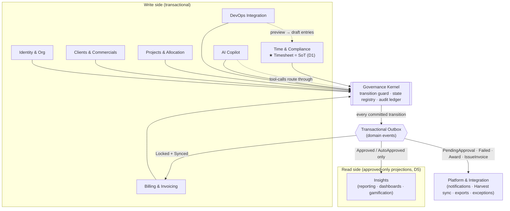

**Reading the map:** every context performs state changes *only* through the Governance Kernel; the Kernel emits each committed transition to the outbox; the worker relays events to **Insights** (built strictly from approved data — D5) and to **Platform & Integration** (notifications, Harvest push). AI tool-calls and DevOps drafts do not bypass the Kernel.

### 6.4 The Governance Kernel — class diagram (heart of FR-GOV-3) — finalised

Every state transition is executed via one mediating service. The class model:

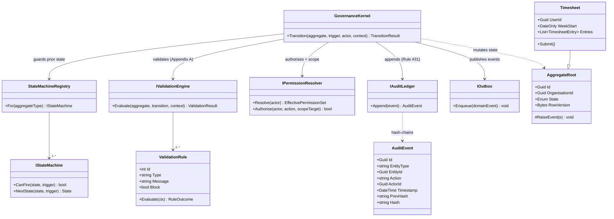

**Transition algorithm (single transactional unit):**

```
GovernanceKernel.Transition(aggregate, trigger, actor, context):
  1. Guard:     prior state permits this trigger?            (StateMachineRegistry) → else reject
  2. Validate:  rule set for this transition passes?         (IValidationEngine)    → else reject / route to PM
  3. Authorise: actor holds required permission + scope?     (IPermissionResolver)  → else deny + security audit
  4. Apply:     mutate aggregate state                       (domain)
  5. Audit:     append immutable, hash-chained AuditEvent     (IAuditLedger)         → on failure ABORT (Rule #31)
  6. Record:    append StateTransition history entry
  7. Publish:   domain event(s) to outbox for projections / integrations
```

Steps 4–7 commit atomically with step 5; if the audit append fails, the whole transition rolls back — satisfying Appendix-A rule #31 ("audit log missing → BLOCK") by construction. This keeps every engine free of repeated cross-cutting checks (D3/D4).

### 6.5 Component view (C4 L3) — Time & Compliance context — finalised

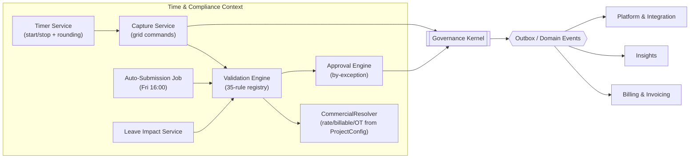

Synthesis note: the **CommercialResolver** is shown here as the single place that turns `ProjectConfiguration` into billable/rate/overtime decisions (D2) — the front-end only *renders* its output (Design System P3), never sets it.

### 6.6 Extraction seams (future scale, NFR-6)

**AI Copilot** (latency-isolated, external model calls), **DevOps Integration** (rate-limited external API, R2), and **Insights/Reporting** (read-heavy projections) already communicate via published domain events + their own read models, so extraction to separate services is a deployment change, not a redesign.

---

## 7. Front-End Architecture (synthesised from the Design System)

The Design System (`docs/DESIGN_SYSTEM.md`) is the authority for the human-facing surface; this section expresses its decisions in technical-architecture terms so the front-end is implementable and traceable. No new product rules are introduced here.

### 7.1 Application shell & module structure

A **three-zone shell** consistent across every authenticated screen (Design System §3.1, §5.1): persistent **left sidebar** (role-aware nav, RBAC-filtered), **top app bar** (breadcrumb/context, ⌘K command palette, notifications, copilot toggle, user menu), **right-edge copilot dock** (collapsible). Routing is feature-foldered to mirror the bounded contexts; a route the user's effective permission set disallows renders an **AccessDenied** state and **logs a security event** (FR-IAM-8, AC-IAM-4) — never a silent 404.

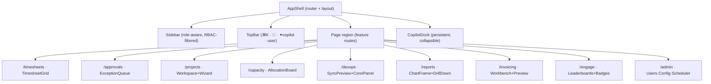

### 7.2 State & data layers

| Concern | Approach | Trace |
|---|---|---|
| Server state | **TanStack Query** caches; mutations are **optimistic** for grid hour edits, reconciled by the server validation result ≤300ms later (revert + block message on rejection) | Design System §4.2, NFR-4 |
| Realtime | **SignalR client** feeds validation severities, gamification celebrations, and report refresh into Query cache + `aria-live` regions | Design System §4.1, §10; FR-REP-6, FR-GAM-5 |
| Client validation | **React Hook Form + Zod**, schemas generated to **mirror** server FluentValidation for instant feedback; **server remains authoritative (ADR-016)** — commercial fields are display-only | Design System §9; D2 |
| Forms/tokens | **Style Dictionary → CSS vars → Tailwind** (light-first, dark = remap; density = Comfortable/Compact) | ADR-015/019 |
| Grid | **TanStack Table v8 + Virtual**, rendered as a **proper ARIA grid** (arrow-key navigation, Enter to edit, Esc to cancel) | Design System §7.2, §10 |

### 7.3 The validation severity contract (35 rules → 3 severities)

The front-end maps the Appendix-A matrix onto exactly three severities; the mapping is data-driven from each rule's `{type, block}` so new rules need no UI change:

| Severity | Appendix-A source | Visual (colour **+ icon + text**, never colour-alone) | Behaviour |
|---|---|---|---|
| **Block** | `BLOCK` rules (#1, #3, #6, #10, …) | red border + ✕ + inline message + cell dot | prevents save/submit of the entry; submission gate disabled |
| **Warning** | `NO BLOCK (warning)` (#7, #8, #19, …) | amber accent + △ + message | save allowed; surfaces in submission summary; may route to PM |
| **Info/status** | informational `NO BLOCK` (#16, #22, #34) | neutral/blue chip/banner + ⓘ | no obstruction; informs of system behaviour |

Results write to `aria-live` (`polite` for warning/info, `assertive` for blocks and submission failures) so the ≤300ms feedback is non-visual-equivalent (WCAG 4.1.3).

### 7.4 Status vocabulary alignment (ADR-018)

The Design System's **StatusChip** renders the *persisted aggregate state* (the §11 state machines) with a fixed colour+icon+label per state family. FR-TS-9's "In Progress / Validation Warning / Compliant / Ready for Submission" are **derived display statuses** computed client-side from the `Draft` aggregate state plus the live validation result — they are never persisted states. This reconciles PRD §9 (state machine) with FR-TS-9 (UI surface) without inflating the state machine.

### 7.5 Responsive & accessibility commitments

- **Desktop-first, degrade gracefully** across `xs→xl` (Design System §7). The 7-column timesheet grid **transforms** rather than scales: full grid on `lg+`, frozen-first-column scroll on `md`, day-by-day stacked view on `xs/sm`.
- **WCAG 2.1 AA is the floor** (NFR-7): colour never the only signal; full keyboard operability; visible focus; focus trapping in modals/drawers/dock; `prefers-reduced-motion` degrades gamification confetti to a static card; **axe in CI** + manual NVDA/VoiceOver passes on capture→submit, approval, invoice issue.

### 7.6 Front-end ↔ back-end contract summary

The SPA consumes the REST + SignalR contracts owned by this TDD (§11–§13). Hours are decimal end-to-end (ADR-017). Commercial fields (rate/billable/overtime) arrive **resolved** and are rendered read-only (P3/D2). Every AI-populated field carries an "✦ AI" attribution marker until the user edits/confirms it (FR-AI-10).

---

## 8. Cross-Cutting Concerns

| Concern | Design | Reqs |
|---|---|---|
| **State machines** | Centrally registered (Stateless) per aggregate; the *only* legal way to change state is via the Governance Kernel (§6.4, §11). | FR-GOV-3, NFR-14, PRD §9 |
| **Validation engine** | Server rule registry implementing the 35-rule matrix (Appendix A); each rule `{id, condition, type, message, block}`. Runs real-time on entry (SignalR push, ≤300ms) and as a submission gate. Thresholds project-config-driven (NFR-9). Client Zod mirrors it for feedback only (ADR-016). | FR-VAL-*, FR-TS-8 |
| **RBAC & scopes** | Permission resolver produces an *effective permission set* per user (screen/API/feature/admin) with scope (Self/Team/Department/Global). Enforced via API authorization policies + data-scope query filters. Financial data gated from non-finance (AC-IAM-4). | FR-IAM-7/8, NFR-1 |
| **Audit ledger** | Append-only table; each row carries `PrevHash` + `Hash` (hash chain) for tamper-evidence; never updated/deleted; queryable/exportable for regulatory packs. | FR-AUD-*, NFR-2 |
| **Domain events + Outbox** | Transactional outbox in PostgreSQL; worker relays to projections (read models) and integration handlers. Guarantees approved-only projections (D5) and reliable external sync. | FR-GOV-5, FR-REP-6, FR-INT-* |
| **Commercial resolution** | `CommercialResolver` computes billable status, rate (project rate card → user default fallback), and overtime treatment purely from `ProjectConfiguration`; client/user input never trusted. | FR-GOV-2/4, FR-RATE-3, FR-BILL-4 |
| **AI safety harness** | AI requests pass the same RBAC resolver; state-mutating tool-calls route through the Governance Kernel (cannot bypass validation/allocation/holiday/leave guards). Every interaction audited (prompt/response/action/outcome). | FR-AI-2/3/10, NFR-11, Appendix A #28/#29 |
| **Idempotency & concurrency** | Optimistic concurrency (EF `RowVersion`) on aggregates; idempotency keys on integration submissions (Harvest) and timer-stop entry creation. | NFR-3, FR-INT-3 |
| **Configuration over code** | Validation thresholds, overtime policy, rounding, auto-submit windows, gamification weightings, description-quality rules stored as config (JSONB / config tables). | NFR-9 |

---

## 9. Data Model

PRD §10 conceptual model realised as the PostgreSQL relational schema below. Money and hours use `numeric/decimal` (ADR-017). Every aggregate carries `OrganisationId` (ADR-008), `CreatedAt/By`, `UpdatedAt/By`, and `RowVersion`.

### 9.1 Entity-Relationship overview — finalised

```mermaid
erDiagram
    CLIENT ||--o{ PROJECT : has
    CLIENT ||--o{ CONTRACT : holds
    CLIENT ||--o{ RATE_CARD : "client rate"
    PROJECT ||--|| PROJECT_CONFIGURATION : configured_by
    PROJECT ||--o{ TASK : contains
    TASK ||--o{ SUBTASK : contains
    PROJECT ||--o{ PROJECT_ASSIGNMENT : staffed_by
    USER ||--o{ PROJECT_ASSIGNMENT : assigned
    PROJECT ||--o{ RATE_CARD : "project rate"
    PROJECT ||--|| DEVOPS_CONFIGURATION : integrates
    DEVOPS_CONFIGURATION ||--o{ DEVOPS_TICKET : syncs
    DEVOPS_CONFIGURATION ||--o{ DEVOPS_TICKET_MAPPING : maps
    DEVOPS_CONFIGURATION ||--o{ DEVOPS_REFRESH_LOG : logs
    USER ||--|| ROLE : has
    ROLE ||--o{ ROLE_PERMISSION : grants
    PERMISSION ||--o{ ROLE_PERMISSION : in
    USER ||--o| WORK_RULE : governed_by
    USER ||--o{ TIMESHEET : owns
    TIMESHEET ||--o{ TIMESHEET_ENTRY : contains
    PROJECT ||--o{ TIMESHEET_ENTRY : booked_to
    TASK ||--o{ TIMESHEET_ENTRY : against
    TIMESHEET_ENTRY ||--o{ TIME_ENTRY_REVISION : versioned_by
    TIMESHEET_ENTRY ||--o| DEVOPS_TICKET : references
    USER ||--o{ TIMER_SESSION : runs
    USER ||--o{ LEAVE_REQUEST : requests
    USER ||--o{ ALLOCATION_SNAPSHOT : measured_by
    PROJECT ||--o{ INVOICE : billed_in
    INVOICE ||--o{ INVOICE_LINE : has
    INVOICE_LINE ||--o{ INVOICE_ENTRY_LINK : sources
    TIMESHEET_ENTRY ||--o| INVOICE_ENTRY_LINK : billed_once
    INVOICE ||--o{ PAYMENT : receives
    USER ||--|| USER_SCORE : scores
    USER ||--o{ POINTS_TRANSACTION : earns
    USER ||--o{ USER_BADGE : awarded
    BADGE ||--o{ USER_BADGE : as
    USER ||--|| AI_AGENT_PROFILE : provisioned
    AI_AGENT_PROFILE ||--o{ AI_INTERACTION : records
    AI_AGENT_PROFILE ||--o{ AI_MEMORY : remembers
    USER ||--o{ NOTIFICATION : receives
    NOTIFICATION_TEMPLATE ||--o{ NOTIFICATION : renders
    REPORT_SNAPSHOT ||--o{ KPI_RESULT : aggregates
    USER ||--o{ AUDIT_EVENT : actor_of
    AUDIT_EVENT ||--o| AUDIT_EVENT : prev_hash_of
```

> The audit ledger logically references *any* aggregate by `(EntityType, EntityId)`; the self-relation above shows the hash chain (`prev_hash_of`). `StateTransition` rows (history) are 1:1 with kernel transitions and omitted from the diagram for clarity (see §9.2).

### 9.2 Aggregate & table summary (key fields / constraints)

| Aggregate / table | Key fields | Critical constraints | Reqs |
|---|---|---|---|
| **User** | id, email (unique/org), status, roleId, departmentId, managerId, employmentType, workRuleId, lastLoginAt | Status state machine (Invited→Active→Disabled/Locked/Terminated); temp password + forced reset | FR-IAM-*, FR-WF-2 |
| **Role / Permission / RolePermission** | role id/name; permission key, scope | Effective permission set derived | FR-IAM-7 |
| **WorkRule / PublicHoliday** | daily/weekly hours, working days, country, calendar; holiday date/region | ≥1 holiday seeded (FR-CFG-2) | FR-CFG-*, FR-WF-2 |
| **Client** | id, code (unique), status, currency, taxNumber, billingAddress, contacts | Lifecycle create→active→archived | FR-CLI-* |
| **Contract / BillingProfile / RateCard** | rate type (cost/billing), amount, currency, effectiveFrom/To, projectId/clientId | Effective-dated; history preserved (append-only, no destructive edit) | FR-RATE-1/2, FR-CLI-2 |
| **Project** | id, code (unique), clientId, type, status, pmId, start/end, priority | Lifecycle state machine; not ACTIVE ⇒ no logging/billing/sync | FR-PRJ-2/14 |
| **ProjectConfiguration** | budgetHours, budgetValue, billingModel, rateCardRef, overtime{allowed, billable, multiplier, maxThreshold, approvalRequired}, compliance{minDesc, minHours, descQuality}, **strictAllocation**, approvalWorkflow, devOpsRef | **Sole authority for commercial behaviour (D2)** | FR-PRJ-4/8/10, FR-GOV-2 |
| **Task / SubTask** | name, workType, budget, status, ownerId, projectId | Appear in timesheet selection; inherit project context | FR-PRJ-7 |
| **ProjectAssignment** | userId, projectId, projectRole, allocationPct, start/end | Σ allocation ≤ 100% (block); target hours derived | FR-ALLOC-1/3 |
| **AllocationSnapshot** | userId, week, expected, allocated, actual, utilisation | Reporting basis | FR-ALLOC-6 |
| **Timesheet (SoT)** | id, userId, weekStart, status, totals, submittedAt, approvedAt, lockedAt | Master record (D1); state machine; locked ⇒ immutable | FR-TS-*, NFR-3, PRD §9 |
| **TimesheetEntry** | id, timesheetId, projectId, taskId, workType, date, hours `numeric(5,2)`, description, billableResolved, overtimeFlag, devOpsTicketRef | hours 0<h≤24; no overlap/dupes; entry state machine | FR-VAL-1/2/3, Appendix A |
| **TimeEntryRevision** | entryId, before/after, changedBy, reason | Audit/version history | FR-AUD-1 |
| **TimerSession** | userId, projectId, taskId, workType, startedAt, stoppedAt, roundingRule, idempotencyKey | On stop → entry + validation | FR-TIMER-* |
| **LeaveRequest** | userId, type, start/end, status, approverId | Approval workflow; reduces expected hours | FR-LEAVE-* |
| **DevOpsConfiguration** | projectId, orgUrl, board, **encryptedPat**, assignedEmail, areaPathMap, workItemTypeMap, autoSyncRules, activeStatuses, connectionState | PAT encrypted at rest; connection state machine | FR-ADO-1/3/10, R3 |
| **DevOpsTicket / DevOpsTicketMapping / DevOpsRefreshLog** | ticketNo, title, status, estimate, remaining; mapping rules/overrides; refresh summary | Active-status filter; unmapped = warning | FR-ADO-4/5/8 |
| **Invoice** | id, clientId, projectId, period, status, currency, subtotal, vat, total, **snapshotJson** | State machine; issued ⇒ immutable snapshot + lock | FR-INV-11/12 |
| **InvoiceLine** | invoiceId, type(standard/overtime), workType, hours, rate, amount | Overtime separated; OT only if project allows | FR-INV-4, FR-BILL-4 |
| **InvoiceEntryLink** | invoiceLineId, timesheetEntryId | **Unique per entry ⇒ prevents double billing** | FR-INV-11, NFR-3 |
| **Payment** | invoiceId, amount, receivedAt, type | Receivables (SHOULD) | FR-INV-13 |
| **UserScore / PointsTransaction** | userId, totalPoints; txn{reason, points, sourceRef} | Points only post-approval; project-rule gated | FR-GAM-1/2 |
| **Badge / UserBadge / Leaderboard** | criteria, tier; awardedAt; scope/period/rankings | Badge & leaderboard state machines; revocation on streak break | FR-GAM-3/4/5/6 |
| **AIAgentProfile / AIInteraction / AIMemory** | rolePrompt, permissionContext, prefs; prompt, response, action, outcome, securityContext; memory items | Auto-provisioned per user; full audit | FR-AI-1/9/10 |
| **Notification / NotificationTemplate** | userId, channel, status, payload; template body | State machine (Queued→Sent→Delivered→Read; retry) | FR-NOT-6 |
| **ExceptionCase** | type, classification, route, status | Exception state machine | FR-EXC-* |
| **ReportSnapshot / KPIResult** | scope, period, metrics (derived, approved-only) | Built from events; no stale cache on refresh | FR-REP-5/6 |
| **AuditEvent (ledger)** | id, entityType, entityId, action, actorId, timestamp, payload, **prevHash, hash** | Append-only, hash-chained, immutable | FR-AUD-1, NFR-2 |
| **StateTransition** | entityType, entityId, fromState, toState, trigger, actorId, at | History for every transition | FR-GOV-3 |

### 9.3 Integrity & immutability rules (enforced at domain + DB)
- Unique: `Client.code`, `Project.code`, `User.email` (per org), **`InvoiceEntryLink.timesheetEntryId` (double-bill guard)**.
- No overlapping `TimesheetEntry` per user/day; duplicate-entry detection (Appendix A #2/#33).
- Locked/Approved/Paid records reject mutation at the domain layer (Appendix A #30), enforced before any persistence.
- Rate cards/contracts are append-only with effective dates — corrections create new versions (FR-RATE-1).
- `OrganisationId` present on all aggregates; global query filter wired, defaulted to the single org (ADR-008).

---

## 10. Key Runtime Flows — finalised

Seven canonical flows. Each runs through the Governance Kernel for any state change.

### 10.1 Login → role context + AI context load (FR-IAM-1/11, FR-AI-2)

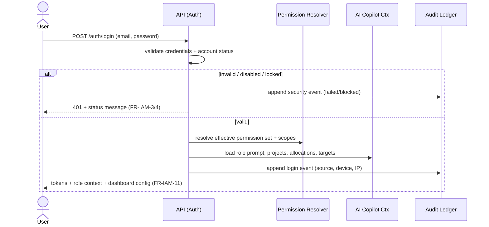

### 10.2 Capture → Validate → Submit → Auto-approve (FR-APR-1/2)

```mermaid
sequenceDiagram
    actor U as Consultant
    participant API as API
    participant VAL as Validation Engine
    participant GK as Governance Kernel
    participant APR as Approval Engine
    participant EVT as Outbox/Events
    U->>API: Submit timesheet
    API->>VAL: Run full rule set (Appendix A)
    alt block-level failures
        VAL-->>API: blocked (reasons)
        API-->>U: cannot submit; submission summary lists blocks (FR-AUTO-3)
    else passes blocks; all auto-approval conditions met (FR-APR-2)
        VAL-->>APR: pass
        APR->>GK: Submitted -> AutoApproved -> Locked
        GK->>EVT: publish Approved (points, billing, reporting, Harvest sync)
        API-->>U: Auto-approved + PM notified (info only)
    else passes blocks; an auto-approval condition fails
        VAL-->>APR: exceptions (allocation/OT/missing desc)
        APR->>GK: Submitted -> PendingApproval
        GK->>EVT: publish PendingApproval (PM queue)
        API-->>U: Routed to PM approval queue
    end
```

### 10.3 Timer stop → rounded entry (FR-TIMER-2/3)

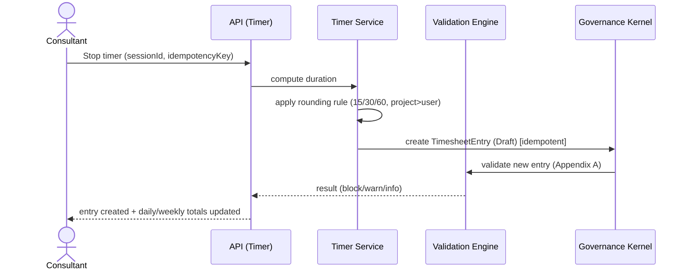

### 10.4 DevOps refresh → preview → draft entries (FR-ADO-1..7)

```mermaid
sequenceDiagram
    actor U as Developer
    participant API as API (DevOps)
    participant ACL as ADO Client (anti-corruption)
    participant MAP as Mapping Engine
    participant TC as Time & Compliance
    U->>API: Refresh DevOps
    API->>ACL: handshake (validate org/PAT/permissions)
    alt handshake fails
        ACL-->>API: specific failure (auth/permission/PAT/org/project)
        API-->>U: connection Failed + recovery guidance (state machine)
    else connected
        API->>ACL: query assigned work items + status + estimates
        ACL-->>API: tickets
        API->>API: filter active statuses; normalise (Project|Ticket|Status|Description)
        API->>MAP: apply area-path / work-item mapping + overrides
        MAP-->>API: mapped (unmapped flagged = warning, no block #19)
        API-->>U: preview table (accept/edit/skip per row)
        U->>API: accept selection (+ optional mapping override save)
        API->>TC: populate Draft entries ([Ticket]-[Desc] + estimate meta)
    end
```

### 10.5 AI timesheet assist — human-in-the-loop (FR-AI-2/3/10)

```mermaid
sequenceDiagram
    actor U as Consultant
    participant API as API (AI)
    participant RBAC as Permission Resolver
    participant AIP as IAiProvider
    participant GUARD as Allocation/Holiday/Leave Guards
    participant GK as Governance Kernel
    participant AUD as Audit Ledger
    U->>API: "Fill my missing hours"
    API->>RBAC: authorise request (scope)
    alt out of scope (e.g. dev asks finance report)
        API->>AUD: audit denied request
        API-->>U: explained denial (AC-AI-2) — never blank
    else in scope
        API->>AIP: scoped prompt (minimal context)
        AIP-->>API: suggested entries/descriptions
        API->>GUARD: clamp to allocation; exclude holiday/leave (#28/#29)
        API-->>U: dashed AI-draft suggestions (Accept/Edit/Reject)
        U->>API: Accept (commit)
        API->>GK: create/modify entries (validated)
        GK->>AUD: audit prompt/response/action/outcome (FR-AI-10)
    end
```

### 10.6 Invoice generate → finance review → issue (immutable) (FR-INV-3..11)

```mermaid
sequenceDiagram
    actor PM as PM
    actor FIN as Finance
    participant API as API (Billing)
    participant COMM as CommercialResolver
    participant GK as Governance Kernel
    PM->>API: Generate invoice (project, period)
    API->>API: extract approved/compliant billable entries (exclude draft/leave/holiday/non-billable)
    API->>COMM: resolve rates (project card -> user default) + separate overtime
    API->>GK: create Invoice (Draft) + InvoiceLines + InvoiceEntryLinks (unique)
    Note over API: Draft auto-syncs as timesheets change (FR-INV-9)
    FIN->>API: review (approve / reject / adjust / return)
    FIN->>API: Issue
    API->>GK: Draft->Generated->Approved->Sent ; create immutable snapshotJson + Lock
    GK-->>FIN: PDF invoice + annexures; entries cannot be billed twice (#30, NFR-3)
```

### 10.7 Auto-submission scheduler (Friday 16:00) (FR-AUTO-1..4)

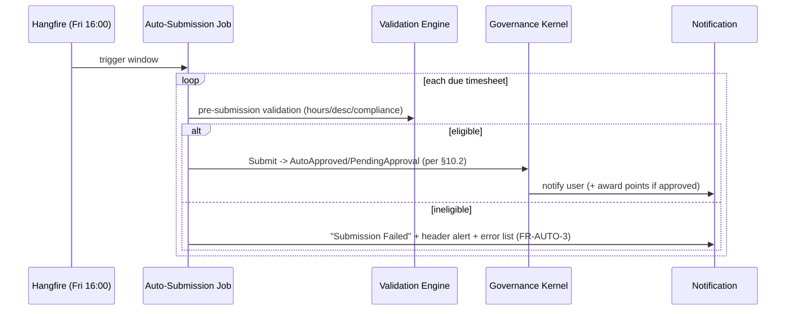

---

## 11. State Machines (centrally enforced) — finalised

All machines below are registered in the Governance Kernel; the **master rule** applies to every transition: *no transition occurs unless validation passes, the actor is permitted, an audit record is created, the prior state allows it, and the transition is recorded* (FR-GOV-3). Persisted states are canonical (ADR-018).

**Timesheet** (PRD §9)
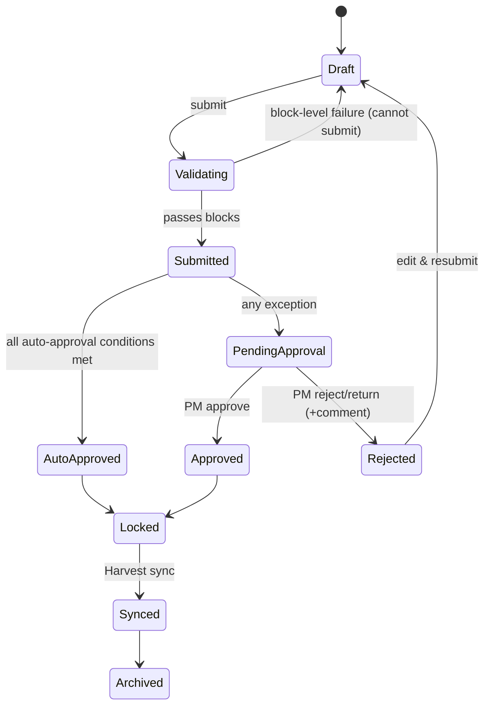

**Timesheet Entry**
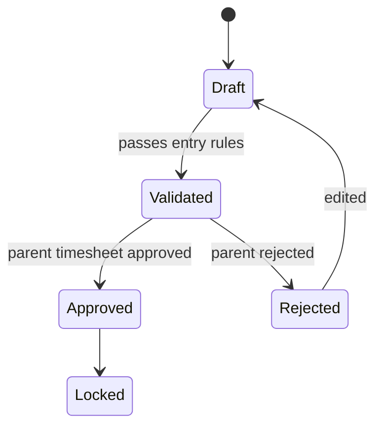

**Project** (per-state rules in §9.2 ProjectConfiguration)
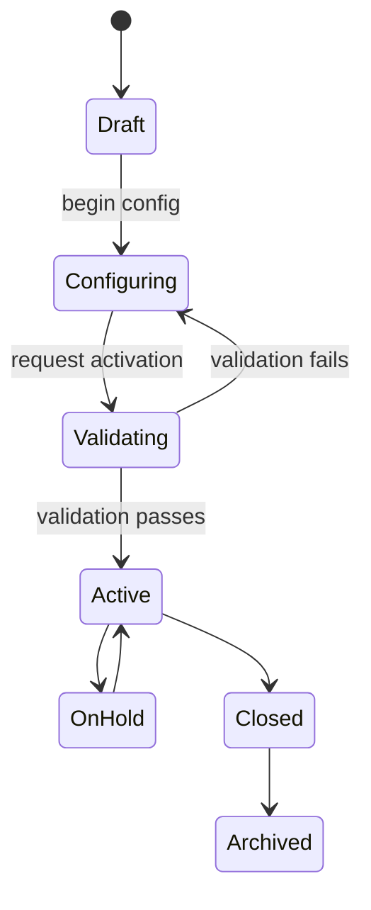

**User**
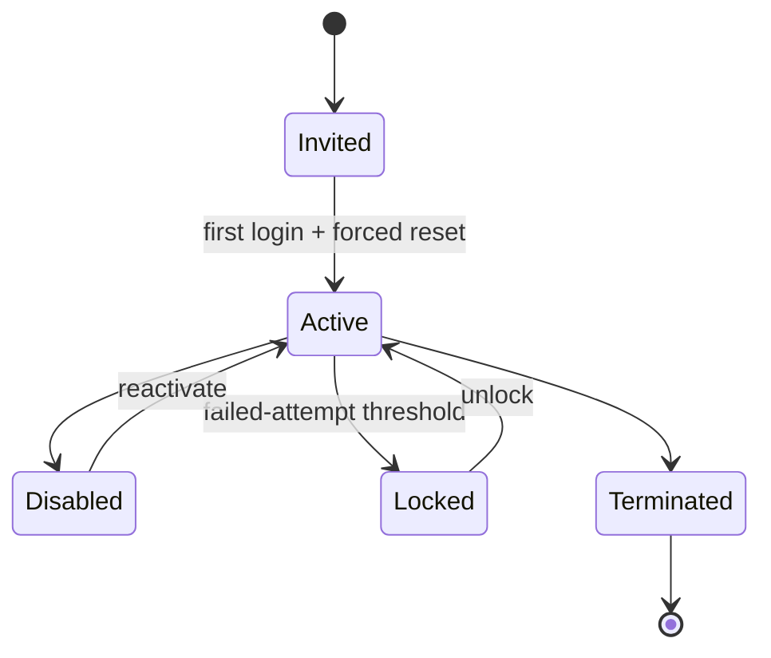

**Azure DevOps Connection**
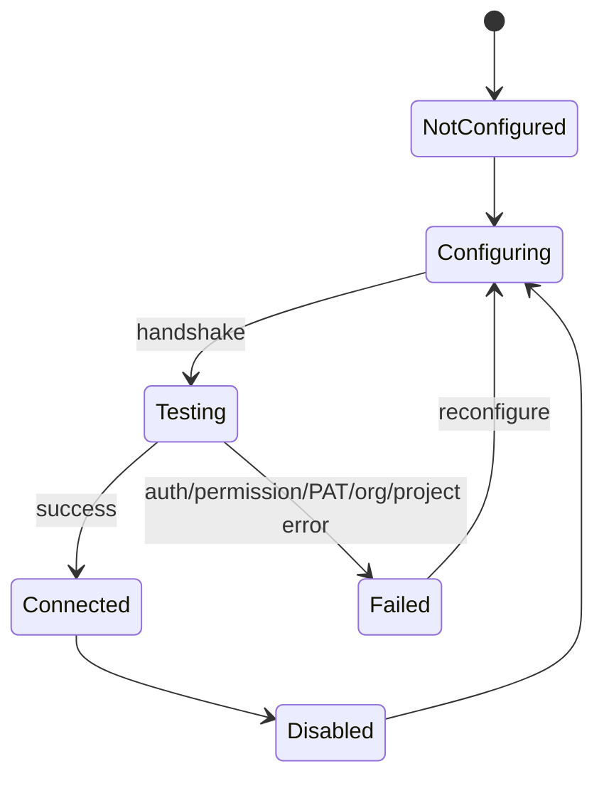

**DevOps Refresh** (Connected required; Failed cannot schedule — FR-ADO-10)
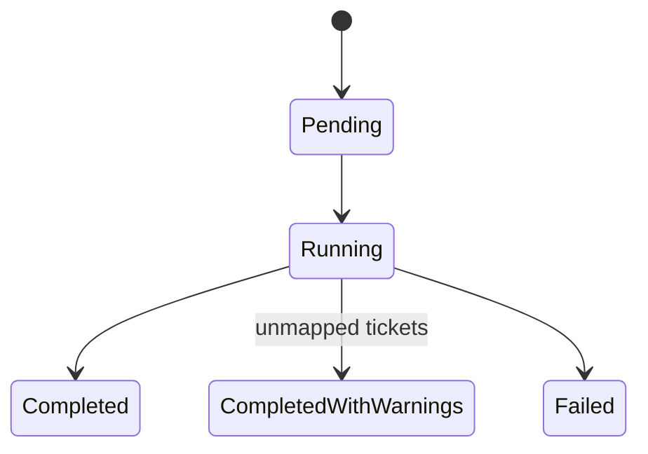

**Invoice**
```mermaid
stateDiagram-v2
    [*] --> Draft
    Draft --> Generated
    Generated --> Approved
    Approved --> Sent
    Sent --> PartiallyPaid
    PartiallyPaid --> Paid
    Sent --> Paid
    Paid --> Archived
    Draft --> Cancelled
    Generated --> Cancelled
    Approved --> Cancelled
```
> `Paid` and `Cancelled` invoices are immutable but retained for audit (FR-INV-12).

**Badge**
```mermaid
stateDiagram-v2
    [*] --> NotEarned
    NotEarned --> Earned: criteria met (post-approval)
    Earned --> Displayed
    Displayed --> Revoked: streak criterion breaks
    Revoked --> Earned: re-qualifies
```

**Leaderboard**
```mermaid
stateDiagram-v2
    [*] --> Calculating
    Calculating --> Published
    Published --> Calculating: refresh schedule
    Published --> Archived: period close
```

**Notification**
```mermaid
stateDiagram-v2
    [*] --> Queued
    Queued --> Sent
    Sent --> Delivered
    Delivered --> Read
    Sent --> Failed
    Failed --> Sent: retry
```

**AI Request**
```mermaid
stateDiagram-v2
    [*] --> Submitted
    Submitted --> Processing
    Processing --> Completed
    Processing --> Failed
    Submitted --> Cancelled
    Processing --> Cancelled
```

**Report Generation**
```mermaid
stateDiagram-v2
    [*] --> Requested
    Requested --> Generating
    Generating --> Completed
    Generating --> Failed
    Completed --> Published
```

**Exception / Leave** (representative; Compliance/Harvest-Sync/Audit follow the same kernel rule)
```mermaid
stateDiagram-v2
    state Exception {
        [*] --> Detected
        Detected --> Classified
        Classified --> Routed
        Routed --> Resolved
        Routed --> Escalated
        Escalated --> Resolved
        Resolved --> Closed
    }
    state Leave {
        [*] --> Requested
        Requested --> Approved
        Requested --> Rejected
        Approved --> Cancelled
        Rejected --> [*]
    }
```

---

## 12. Integration Points & Contracts

| Integration | Protocol / library | Key operations | Reliability / failure handling | Reqs |
|---|---|---|---|---|
| **Azure DevOps** | REST / TFS client, PAT auth | Handshake (validate org/PAT/permissions), query assigned work items, statuses, estimates | Connection state machine; specific failure codes; retries; cache normalised data; rate-limit aware (R2) | FR-ADO-1..10, NFR-10 |
| **Harvest** | REST, outbound | Submit approved timesheets, reconcile, status monitor | Idempotency keys, retry with backoff, failure recovery + audit, scheduled submission | FR-INT-3, R10 |
| **Azure AD / Keycloak** | OIDC / Microsoft.Identity.Web | Federated login, SSO, provisioning + attribute sync | Pluggable `IAuthProvider`; local auth fallback; last-login update | FR-IAM-9 |
| **AI provider** | HTTPS SDK (Claude / Azure OpenAI) | Scoped prompt/response, tool-calling for assist actions | `IAiProvider` abstraction; per-org budget ceiling; minimal-context/PII policy; graceful degradation; full audit | FR-AI-*, NFR-11 |
| **Email** | SMTP / provider API | Notifications, invoice delivery | Notification state machine + retries | FR-NOT-1/6 |
| **Microsoft Teams** | Graph / incoming webhook | Notifications | SHOULD; channel abstraction | FR-NOT-1 |
| **Export targets** | File/Blob, Power BI, DWH | PDF/Excel/CSV; scheduled distribution | Audit traceability embedded in exports | FR-EXP-1/2/3 |

**Contract principle:** all external interactions go through an **anti-corruption layer** (a dedicated client per integration) so external schema changes never leak into the domain. Secrets (PATs, credentials) are encrypted at rest and never logged (R3).

---

## 13. API Surface & Conventions (new — implementation guidance)

To keep the SPA contract (§7.6) and the back-end aligned, the following conventions are binding for Epics & Stories:

- **Style:** resource-oriented REST over HTTPS; commands as `POST /…/{action}` where a verb is clearer than CRUD (e.g. `POST /timesheets/{id}/submit`). Read models served by query endpoints under `/reports`, `/dashboards`.
- **Realtime:** SignalR hub channels per concern (`validation`, `gamification`, `reports`); the SPA subscribes by current screen.
- **Hours & money:** decimal in JSON (`"hours": 7.5`, `"amount": 1234.50`), formatted client-side via Intl (ADR-017); never floats with binary rounding for money.
- **Commercial fields are response-only.** Rate/billable/overtime appear in responses (resolved by `CommercialResolver`) and are rejected if sent in a write payload (D2/ADR-016).
- **Errors:** a single problem-details envelope `{ code, message, recovery, fieldErrors[] }`; validation responses carry Appendix-A `{ruleId, severity, message}` so the client maps to the §7.3 severity contract. Messages use the exact Appendix-A copy + recovery hint (Design System §11).
- **Idempotency:** `Idempotency-Key` header honoured on timer-stop and Harvest submit.
- **Concurrency:** `If-Match` with `RowVersion` ETag on aggregate writes; `412` on conflict.
- **AuthZ:** every endpoint declares a policy (permission key + scope); denials log a security event (FR-IAM-8).
- **Pagination/filtering:** cursor pagination for large tables (audit ledger, entries); server-side filtering for reports.

---

## 14. Security Design & Assumptions

| Area | Design / decision | Reqs |
|---|---|---|
| **Authentication** | Local email/password (Identity) with access/refresh JWTs, configurable session timeout, active-session registry; optional MFA; optional OIDC federation (ADR-009). | FR-IAM-1/2/6/9, NFR-1 |
| **Authorisation** | Role-based with Self/Team/Department/Global scopes; effective permission set per user; API policies + data-scope query filters; screen-access denial logs a security event + "Access Denied" (FR-IAM-8). | FR-IAM-7/8 |
| **Financial data protection** | Invoicing/rate data accessible only to Finance/authorised roles; non-finance access denied + audited; financial nav hidden entirely (Design System §3.2). | AC-IAM-4, NFR-1 |
| **Secret management** | PAT/credentials envelope-encrypted at rest (Key Vault in cloud, env key locally); least-privilege; never logged; access audited. | R3, NFR-1 |
| **Audit & tamper-evidence** | Hash-chained append-only ledger; 100% of state transitions logged; queryable/exportable regulatory packs. | NFR-2, FR-AUD-* |
| **AI governance** | Permission-gated; state-mutating actions via Governance Kernel only; allocation/holiday/leave hard guards; full prompt/response/action audit; data-minimisation to provider. | NFR-11, FR-AI-2/3/10 |
| **Privacy (POPIA/GDPR)** | Privacy-by-design, access logging, configurable retention, least-privilege, regional handling. | NFR-13, R11 |
| **Transport / storage** | TLS in transit; encryption at rest for DB and object store; CORS + secure headers on API. | NFR-1 |
| **Input integrity** | Server-side validation of all commercial fields; client values for rate/billable/overtime ignored (D2/ADR-016). | FR-GOV-2/4 |

`ASSUMPTION` (deployment-time, not blocking design) — concrete KMS/Key Vault provider and MFA method confirmed at infra provisioning.

---

## 15. Non-Functional Mapping

| NFR | How the architecture meets it |
|---|---|
| NFR-1 Security/Access | RBAC + scopes, MFA, federation, envelope-encrypted secrets, audited security events. |
| NFR-2 Auditability | Governance Kernel makes audit a precondition of every transition; hash-chained ledger; exportable. |
| NFR-3 Data Integrity | Single Timesheet aggregate (D1); unique/no-overlap constraints; immutable locked/approved/paid; InvoiceEntryLink uniqueness. |
| NFR-4 Performance | Optimistic-concurrency OLTP, indexed queries, Redis cache, SignalR ≤300ms validation, read-model projections for fast grid/report loads (≤2s grid). |
| NFR-5 Availability/Resilience | Stateless API (scale-out), Redis backplane, Hangfire retries, integration retry/recovery, backup/DR in deployment. |
| NFR-6 Scalability | Separate worker process; async jobs never block interactive use; extractable high-load modules (§6.6). |
| NFR-7 Usability/Accessibility | Responsive React SPA (§7), role-aware nav, guided capture, WCAG 2.1 AA with axe-in-CI + SR passes. |
| NFR-8 i18n | Country/timezone/holiday-aware config; multi-currency data model; react-i18next + Intl; ZAR default. |
| NFR-9 Configurability | Project-config-governed rules; config tables/JSONB for thresholds, overtime, rounding, windows, weightings. |
| NFR-10 Integration Reliability | Validated handshakes, anti-corruption clients, health monitoring, friendly failure messages with recovery guidance. |
| NFR-11 AI Safety | AI bound by RBAC + Governance Kernel + hard guards; audited; graceful degradation. |
| NFR-12 Observability | OpenTelemetry traces/metrics, structured Serilog logs, Hangfire dashboard, health endpoints. |
| NFR-13 Compliance/Privacy | Privacy-by-design, access logging, retention, least-privilege. |
| NFR-14 Maintainability | Modular bounded contexts, centrally enforced state machines, configuration over code, NetArchTest. |

---

## 16. Deployment Assumptions

- **Packaging:** Docker images — `intrvl-api`, `intrvl-worker`, `intrvl-web` (static SPA via nginx or API host), plus `postgres`, `redis`, object store (S3-compatible / Azure Blob; local MinIO).
- **Orchestration:** Docker Compose for local and lightweight environments; container platform (AKS/ECS/Kubernetes) for higher environments. `ASSUMPTION` — target cloud confirmed at infra provisioning.
- **Configuration:** 12-factor env-var config; secrets from Key Vault/secret store (env-provided locally). Separate config per environment (Local/UAT/Prod).
- **Migrations:** EF Core migrations applied on deploy via an idempotent migration step; never auto-destructive.
- **Seed runner:** a dedicated, idempotent seed command/job provisions the UAT dataset (§18) — runnable on deploy to a fresh environment.
- **Environments:** Local → UAT (pre-seeded, demonstrable) → Production. Availability target ≥ 99.5% (NFR-5) with backup/DR/retention at the platform tier.
- **CI/CD:** build/test/lint pipeline (incl. axe a11y + NetArchTest); container build/publish; migration + seed stages gated for UAT. `ASSUMPTION` — pipeline tool confirmed at infra provisioning.

---

## 17. Local Run Strategy

Goal: a single command brings up a fully working, pre-seeded environment so every PRD flow is demonstrable locally (FR-SEED-9).

**Primary path — Docker Compose**
1. `docker compose up` starts `postgres`, `redis`, `minio`, `intrvl-api`, `intrvl-worker`, `intrvl-web`.
2. API entrypoint applies EF Core migrations, then runs the **idempotent UAT seed** (§18).
3. Web SPA available at a mapped port; API at a mapped port (finalised when scaffolding begins).
4. Default credentials per FR-SEED-2 (`Welcome@123`, forced reset on first login).

**Developer inner-loop (no full rebuild)**
- Backend: `dotnet run` for API + worker against compose-provided Postgres/Redis.
- Frontend: `vite dev` with HMR, proxying to the API.
- Tests: `dotnet test` (xUnit + Testcontainers ephemeral Postgres); `vitest` + `playwright` for frontend/E2E.

**Configuration**
- A committed `.env.example` enumerates required vars (DB, Redis, object store, JWT signing key, data-protection key, AI provider key, optional ADO/Harvest/IdP secrets). Secrets env-provided; none committed. Integrations needing external credentials (ADO PAT, Harvest, AI) **degrade gracefully** when unset so the core capture→validate→submit→approve→report→invoice flow runs fully offline for demos.

**Local AI/integration posture**
- AI provider, Azure DevOps, and Harvest are feature-flagged; when credentials are absent the UI shows the integration as "Not Configured" (matching the connection state machine) and all non-integration flows remain fully functional.

---

## 18. UAT Seed Strategy

The seed (FR-SEED-1..9) is an **idempotent provisioning routine** invoked post-migration; it is part of the architecture (not ad-hoc data) so every environment is demonstrable with no manual setup.

Seeds (exactly per PRD §5.27): users **Connor C / Justice J / Alex G** (roles, permissions, allocations, work types; `Welcome@123` + forced reset); client **Eskom** (Active, T&M, ZAR); project **Eskom Modernisation Programme (ESK-001)** (Active, 5,000 budget hours, overtime allowed, approval required, PM Connor C) with the 12 seed tasks; default work types; South-Africa holiday config (Mon–Fri, 8h/day, 40h/week, ≥1 holiday); gamification config (points/achievements/leaderboards + rules); sample Azure DevOps config (area path `Eskom\Digital`; work-item types User Story/Task/Bug). Post-deploy outcome verified against **AC-SEED-1**.

The seed routine transitions entities through the Governance Kernel where applicable (e.g. project Draft→Active), so seeded data is audit-consistent and state-valid — not back-doored.

---

## 19. Observability & Operations

- **Logging:** structured Serilog with correlation IDs; never logs secrets (R3); security/audit events distinct from app logs.
- **Tracing/metrics:** OpenTelemetry across API ↔ worker ↔ external clients; integration health metrics (ADO/Harvest/AI/mail) for NFR-10/12.
- **Job visibility:** Hangfire dashboard for scheduler/auto-submit/refresh/sync execution history (FR-ADM-2).
- **Health:** liveness/readiness endpoints; platform health dashboards (FR-ADM-3); friendly error surfaces with recovery guidance (NFR-12, CLAUDE.md error-handling guidance).

---

## 20. Conflict-Resolution Log (TDD ↔ Design System) — new

Synthesis reconciled the following points where the technical and UX designs touched the same decision. Each resolution is now an ADR or a binding convention.

| # | Tension | Resolution | ADR / ref |
|---|---|---|---|
| C1 | TDD **deferred** UI component & chart libraries; UX **chose** shadcn/Radix + Tailwind, TanStack Table, Recharts/visx | Adopt the UX choices as locked stack decisions; folded into §3 | ADR-014/015 |
| C2 | UX adds **client-side validation** (RHF + Zod); TDD says commercial fields are server-resolved (D2) | Client validation is **UX-only acceleration**; **server FluentValidation + Governance Kernel authoritative**; commercial fields response-only | ADR-016, §13 |
| C3 | PRD §9 lists a **timesheet state machine**; FR-TS-9 + UX surface "In Progress/Validation Warning/Compliant/Ready" | Persisted aggregate state = canonical; FR-TS-9 labels are **derived display statuses** from `Draft` + live validation, not stored states | ADR-018, §7.4, §11 |
| C4 | Hours display ambiguity (decimal vs hh:mm) across PRD/UX | **Decimal end-to-end** (`numeric(5,2)`); hh:mm is display-only formatting | ADR-017, §13 |
| C5 | UX recommends **dark mode**; TDD had no theming stance | Ship **light-first**; dark = token remap (SHOULD); tokens authored now via Style Dictionary | ADR-019, §3 |
| C6 | UX defines **35-rule → 3-severity** visual mapping; TDD owns the 35-rule registry | Severity is **derived from each rule's `{type, block}`**; one server contract, deterministic UI mapping (§7.3) | §7.3, §13 |
| C7 | UX **StatusChip** palette must match the TDD state machines exactly | State families/states in Design System §6.3 are aligned 1:1 with §11 machines; chip renders persisted state only | §7.4, §11 |
| C8 | UX requires **≤300ms** non-visual (aria-live) validation feedback; TDD provides SignalR push | SignalR results feed both the Query cache and `aria-live` regions; SLA bound in ADR-006 | ADR-006, §7.2/7.3 |
| C9 | UX persistent **copilot dock** on every screen vs TDD AI as a bounded context | Copilot is a shell-level front-end element backed by the AI Copilot context; all actions still route through RBAC + Governance Kernel | §6.2, §7.1, §10.5 |

No unresolved conflicts remain. The two documents are mutually consistent as of v2.0.

---

## 21. Architectural Risks & Mitigations

| Ref (PRD) | Risk | Architectural mitigation |
|---|---|---|
| R1 | XL scope (27 engines) | Modular monolith with bounded contexts; MUST-first; extraction seams later; Governance Kernel prevents duplicated cross-cutting logic. |
| R2 | Azure DevOps API/limits | Anti-corruption client, connection state machine, retries, normalised-data cache, rate-limit awareness. |
| R3 | Secret exposure | Envelope encryption at rest, least-privilege, audited access, never logged. |
| R4 | AI non-compliant/leaky output | RBAC + Governance Kernel gating, hard allocation/holiday/leave guards, full audit, human-in-the-loop. |
| R5 | Approval-by-exception mis-auto-approval | Conservative defaults (warn), strict validation gate, configurable strict mode, full audit + PM visibility. |
| R6 | Source-of-truth drift | Single Timesheet aggregate; all reads are event-derived projections from approved data. |
| R7 | Double billing | `InvoiceEntryLink` uniqueness, immutable invoice snapshots, finance review gate, reconciliation. |
| R12 | Real-time validation/report perf at scale | Read-model projections, indexing, Redis cache, async refresh, SignalR push; SLAs bound (ADR-006). |

---

## 22. Traceability — Engine → Bounded Context → Aggregates

| PRD Engine (§5) | Bounded Context (§6.2) | Primary aggregate(s) | FR refs |
|---|---|---|---|
| IAM (5.1), Global Config (5.2), Workforce (5.3) | Identity & Org | User, Role, Permission, Department, Team, WorkRule, PublicHoliday | FR-IAM/CFG/WF-* |
| Client (5.4), Rate (5.17) | Clients & Commercials | Client, Contract, BillingProfile, RateCard | FR-CLI/RATE-* |
| Project (5.5), Allocation (5.6) | Projects & Allocation | Project, ProjectConfiguration, Task, SubTask, ProjectAssignment, AllocationSnapshot | FR-PRJ/ALLOC-* |
| Timesheet (5.8), Timer (5.9), Validation (5.10), Approval (5.11), Auto-Submit (5.15), Leave (5.7) | Time & Compliance | Timesheet, TimesheetEntry, TimerSession, LeaveRequest, TimeEntryRevision | FR-TS/TIMER/VAL/APR/AUTO/LEAVE-* |
| Azure DevOps (5.12) | DevOps Integration | DevOpsConfiguration, DevOpsTicket, DevOpsTicketMapping, DevOpsRefreshLog | FR-ADO-* |
| AI Assistant (5.13) | AI Copilot | AIAgentProfile, AIInteraction, AIMemory | FR-AI-* |
| Billing (5.16), Invoice (5.18) | Billing & Invoicing | Invoice, InvoiceLine, InvoiceEntryLink, BillingSnapshot, Payment | FR-BILL/INV-* |
| Reporting (5.19), Visualization (5.20), Gamification (5.21) | Insights | ReportSnapshot, KPIResult, UserScore, PointsTransaction, Badge, UserBadge, Leaderboard | FR-REP/VIZ/GAM-* |
| Notification (5.14), External Integration (5.22), Admin (5.24), Export (5.25), Exception (5.26) | Platform & Integration | Notification, NotificationTemplate, IntegrationJob, ExceptionCase, ExportJob | FR-NOT/INT/ADM/EXP/EXC-* |
| Audit & Governance (5.23) + FR-GOV-* | Governance Kernel | AuditEvent, StateTransition | FR-AUD/GOV-* |
| UAT Seed (5.27) | (cross-cutting provisioning) | seed routine over all aggregates | FR-SEED-* |

---

## 23. ADR Index & Sign-off Checklist

**ADR index:** ADR-001 modular monolith · ADR-002 .NET/React/Postgres · ADR-003 Harvest outbound · ADR-004 no expenses v1 · ADR-005 pluggable AI (Claude default) · ADR-006 SLAs binding · ADR-007 warn-default allocation · ADR-008 single-org + OrgId · ADR-009 local-auth-first federation · ADR-010 no Harvest migration · ADR-011 ZAR/15% VAT · ADR-012 in-app+email channels · ADR-013 INTRVL/betterharvest · ADR-014 shadcn/Radix+Tailwind · ADR-015 TanStack/Recharts/RHF+Zod/Style Dictionary/Lucide/i18next · ADR-016 server-authoritative validation · ADR-017 decimal hours · ADR-018 persisted-state vs display-status · ADR-019 light-first dark-remap.

**Architect sign-off checklist**
- [ ] Driving forces D1–D5 accepted as binding (§1).
- [ ] ADR-001..019 accepted; "Confirm" items (ADR-004/005/006/011/013) nodded by Sponsor/Finance.
- [ ] Finalised diagrams reviewed: context (§4), container (§5), context map + class + component (§6), ERD (§9.1), 7 sequences (§10), 14 state machines (§11).
- [ ] Front-end architecture (§7) accepted as the implementation contract for the SPA.
- [ ] Conflict-resolution log (§20) accepted; no open TDD↔UX conflicts.
- [ ] API conventions (§13) accepted as binding for Epics & Stories.
- [ ] Security (§14), NFR mapping (§15), and traceability (§22) reviewed.
- [ ] TDD approved by: Lead Architect ▢  PM ▢  UX Lead ▢  Finance (commercial rules) ▢

---

## 24. Closed Synthesis Items (was §19 in the draft)

The v1.0 draft's "Open Items for Synthesis" are now resolved:

1. **Finalise all Mermaid diagrams** → **Done** (§4, §5, §6.3/6.4/6.5, §9.1, §10, §11).
2. **Confirm `ASSUMPTION` items** → **Locked** as ADR-004..019 (§2); residual deployment-time assumptions (KMS provider, target cloud, CI tool, ports/compose names) explicitly flagged as infra-provisioning items, not design blockers.
3. **Confirm stack (ADR-001/002)** → **Locked**; Node/NestJS recorded as documented alternative.
4. **Federation timing (OQ9)** → **ADR-009**: local-auth-first; OIDC behind `IAuthProvider` (SHOULD).
5. **Per-bounded-context component diagrams & version pinning** → Time & Compliance component diagram finalised (§6.5) as the template; remaining contexts follow the identical layering (§6.1) and are expanded during their respective Epics; exact patch versions pinned at scaffolding (§3).

Remaining items are intentionally deferred to **infra provisioning** (KMS/Key Vault provider, MFA method, target cloud, CI tool, concrete ports/compose service names) — none blocks Epics & Stories.

---

*End of TDD v2.0 — Architecture Synthesis complete and architect sign-off ready. Aligned to PRD v1.0 and Design System v1.0; all diagrams finalised; all v1.0 assumptions locked as ADRs; technical↔UX conflicts resolved (§20). Next phase: Epics & Stories (MoSCoW, MUST-first).*
